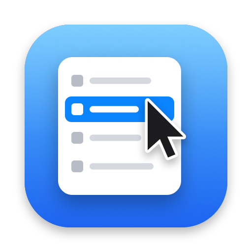
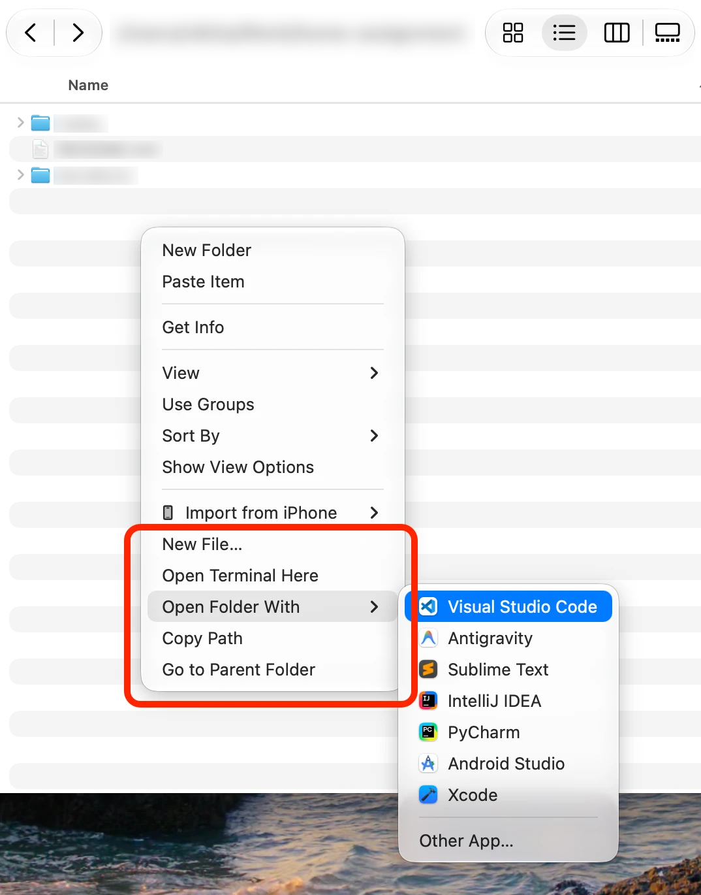

<p align="center">
  
</p>

<h1 align="center">Finder Menu</h1>

<p align="center">Tiny Finder extension adding the right-click options macOS is missing.</p>

<p align="center">
  
</p>

Right-click **empty space** in any folder, with nothing selected:

| &nbsp;&nbsp;&nbsp;&nbsp;&nbsp;&nbsp; | Menu item | What it does |
|:-:|---|---|
| <picture><source media="(prefers-color-scheme: dark)" srcset="docs/icons/new-file-dark.png"></picture> | **New&nbsp;File…** | Asks for a name with any extension (`notes.md`, `main.py`, `.env`), creates it in the current folder and selects it. Never overwrites. |
| <picture><source media="(prefers-color-scheme: dark)" srcset="docs/icons/terminal-dark.png"></picture> | **Open&nbsp;Terminal&nbsp;Here** | Opens iTerm2 (or Terminal, if iTerm2 isn't installed) in the current folder. |
| <picture><source media="(prefers-color-scheme: dark)" srcset="docs/icons/open-with-dark.png"></picture> | **Open&nbsp;Folder&nbsp;With&nbsp;▸** | Opens the current folder in an IDE or editor. Lists the ones you have installed (VS Code, Cursor, Windsurf, Zed, Sublime Text, JetBrains IDEs, Android Studio, Xcode…), plus **Other App…** to pick any app. |
| <picture><source media="(prefers-color-scheme: dark)" srcset="docs/icons/copy-path-dark.png"></picture> | **Copy&nbsp;Path** | Copies the current folder's full path. |
| <picture><source media="(prefers-color-scheme: dark)" srcset="docs/icons/parent-folder-dark.png"></picture> | **Go&nbsp;to&nbsp;Parent&nbsp;Folder** | Moves the window up one level, even when Finder's Back button is greyed out (e.g. a window opened with `open .`). |

Right-clicking a file or folder works too: **Copy Path** copies the selected items' paths, and **Open Terminal Here** and **Open Folder With** use the selected folder.

To add an editor to the list, add its bundle ID to `Sources/Shared/Editors.swift`. You can find an app's bundle ID with `osascript -e 'id of app "AppName"'`.

## Privacy & security

You build Finder Menu yourself from this source, so there's no downloaded app to trust. Everything below can be checked in the code:

- **No network access.** There's no networking code, so nothing is sent anywhere: no telemetry, no analytics, no update checks.
- **Small enough to read.** About 300 lines of Swift and a 46-line `install.sh`. Read the script before you run it.
- **Sandboxed Finder extension.** It can't read your files. It only gets the folder you right-click and the items you select.
- **The helper only acts when you pick a menu item.** It creates an empty file with the name you type (never overwriting anything), opens a terminal or an app in a folder, or moves the Finder window up a level.
- **Links from other apps are checked.** The extension sends actions to the helper as `findermenu://` links. Other apps can send those links too, and so can a website after your browser asks you. So the helper only acts on folders that exist, only opens apps from its built-in IDE list (or one you pick yourself), and always asks before creating a file.
- **One permission.** Go to Parent Folder asks once to control Finder. Finder Menu doesn't ask for Full Disk Access, Accessibility or anything else.
- **Signed locally, not notarized.** `install.sh` signs the build on your Mac ("Sign to Run Locally"). It isn't notarized by Apple, because there's no download for Apple to check.

Found a security problem? See [SECURITY.md](SECURITY.md).

## Install

```bash
git clone https://github.com/nikgrbn/finder-menu.git
cd finder-menu
./install.sh
```

The script builds the app on your machine, installs it to `~/Applications/Finder Menu.app` and enables the Finder extension. There's nothing to launch: Finder loads the extension by itself, including after a restart.

The first time you use **Go to Parent Folder**, macOS asks whether Finder Menu can control Finder. Click **OK**, because that's how it moves the window.

## Uninstall

```bash
./uninstall.sh
```

## Troubleshooting

- **Menu items don't appear:** hold ⌥, right-click Finder in the Dock and choose **Relaunch**. Also check that **Finder Menu** is turned on under System Settings → General → Login Items & Extensions → Finder extensions.
- **Asked for permission again after reinstalling:** expected. Every build is signed locally with a new signature, so macOS asks again.

## How it works

- `Sources/FinderMenuExtension` is a [Finder Sync extension](https://developer.apple.com/documentation/findersync) that adds the menu items to every folder. Finder extensions must run sandboxed, so this part only reads the clicked folder and copies paths.
- `Sources/FinderMenu` is a small helper app that isn't sandboxed and has no Dock icon. The extension hands it actions through a `findermenu://` URL. It creates the files, opens the terminal and moves the Finder window, then quits.
- `Sources/Shared/Editors.swift` is the IDE list. The extension builds the submenu from it, and the helper refuses links naming any app that isn't on it.
- `scripts/make-icon.swift` draws the app icon in code and regenerates `Resources/AppIcon.icns` and `docs/icon.png`.

## License

MIT
